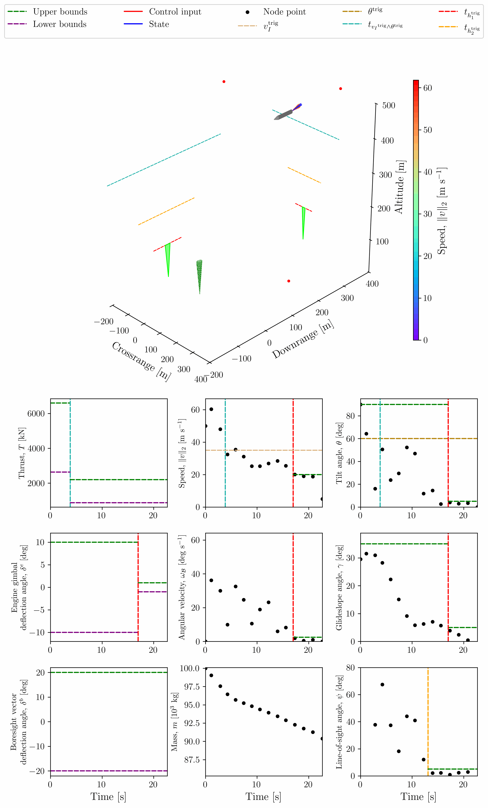
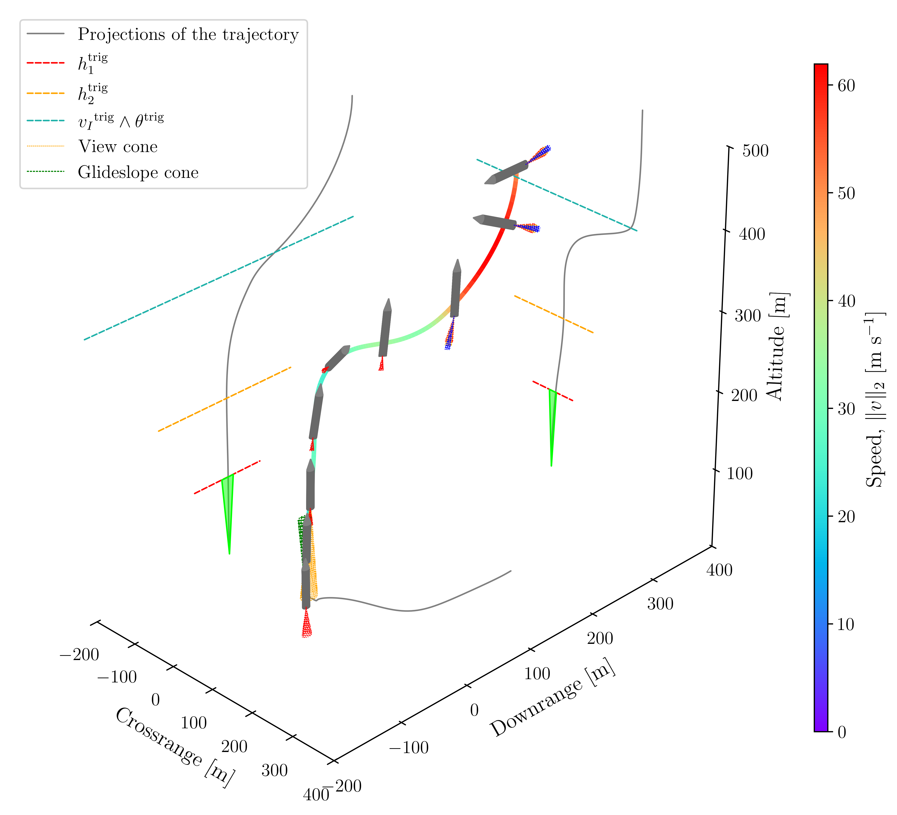
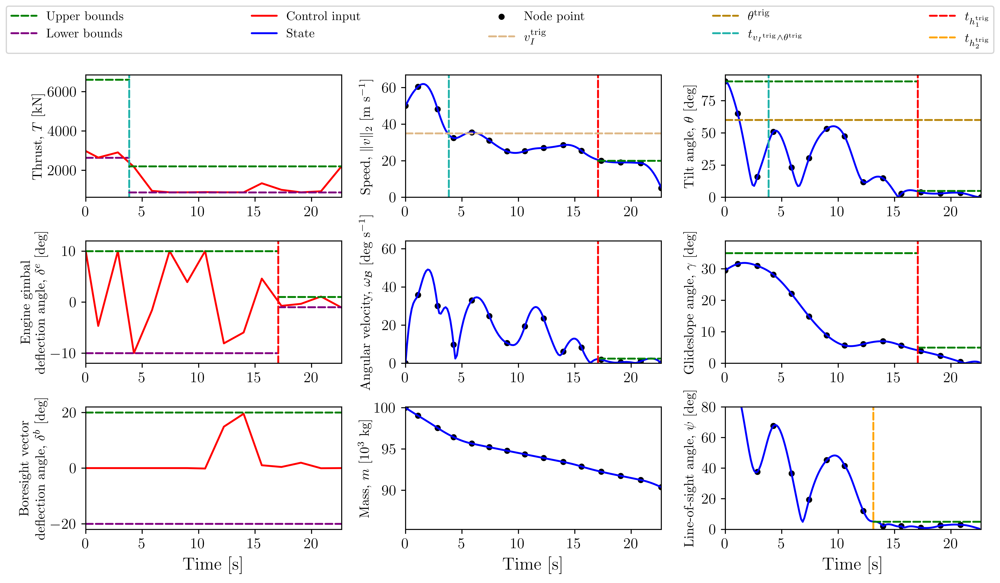

# CT-cSTC

6-DoF powered descent with continuous-time compound state-triggered constraints,
[ICORE](https://github.com/sametuzun781/ICORE), and fast native RK4 discretization.

## Run

Python 3.12 and a C/C++ compiler are required (macOS: `xcode-select --install`).

```bash
python -m pip install -r requirements-comparators.txt
python tools/install_icore.py
python -m ipykernel install --user --name ct-cstc-icore
python run_example.py --backend icore_cpp --audit
```

Or open `CT-cSTC.ipynb` using that kernel. Native libraries build on first use.
ICORE is installed separately from commit `a63ebffb0057`; the installer verifies
the source checksum and omits benchmark-only files. Internet is needed once.
The original 85 fixed-weight + 15 adaptive iterations are preserved; completion
of this budget does not imply convergence. Plot saving and animation are optional.

```python
SOLVER_BACKEND = "icore_cpp"  # cvxpy_qoco, qoco_native, jax_icore, icore_c, icore_cpp
DYNAMICS_AD = "forward"      # forward or reverse
DISCRETIZATION_MODE = "fast" # fast, native, jax, or reference
```

`fast` selects certified native CPU code with JAX fallback; `native` requires it.
`jax` and `reference` both use the original JAX RK4 here. AD applies to that path;
native derivatives are analytic. Recreate prepared functions after parameter edits.
For equation edits, use JAX or regenerate with `python tools/generate_rocket_field.py`
after installing `requirements-dev.txt`, then run `python -m pytest tests -q`.

Raw timings are seconds; notebook timings are milliseconds.
Convex time includes solution input/decode.





## Reference

```bibtex
@inproceedings{uzun2025sequential,
  title={Sequential Convex Programming for 6-DoF Powered Descent Guidance with Continuous-Time Compound State-Triggered Constraints},
  author={Uzun, Samet and Acikmese, Behcet and Carson, John M},
  booktitle={AIAA SCITECH 2025 Forum},
  pages={1895},
  year={2025},
  url={https://doi.org/10.2514/6.2025-1895}
}
```
